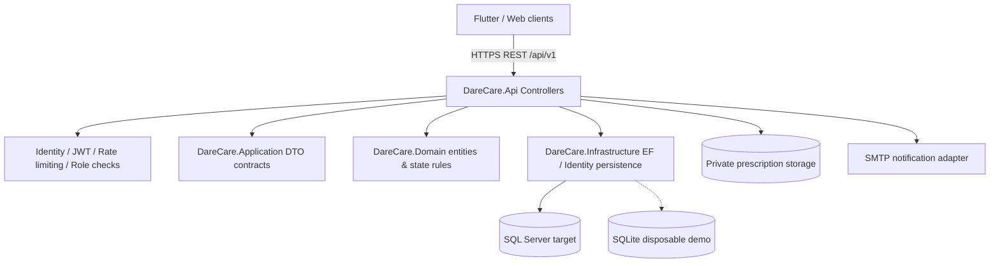

# DareCare — Backend Architecture (As-Is vs Recommended)

## Verified source structure
```text
Flutter Patient App / Nurse-Web / Pharmacy-Web / Admin-Web
                        |
                    HTTPS REST
                        |
              DareCare.Api (.NET 10)
            Controllers, auth, rate limits,
              OpenAPI, health, DI, CORS
                        |
          DareCare.Application (DTO contracts)
                        |
                DareCare.Domain
           entities, booking/order states
                        ^
             DareCare.Infrastructure
            EF Core, Identity, Persistence
                        |
         SQL Server (target persistent store)
         SQLite (temporary development/demo)
```
Source folders: `src/DareCare.Api`, `src/DareCare.Application`, `src/DareCare.Domain`, `src/DareCare.Infrastructure`. API controller currently contains some orchestration/business logic; do not claim full Clean Architecture or CQRS already implemented. **Architecture style:** layered modular monolith, suitable for team scope. Avoid speculative microservices for the graduation MVP.

## Domain modules and boundaries
| Module | Key concepts / invariants |
|---|---|
| Identity | Identity user, Patient/Nurse/Pharmacy/Admin roles, hashed refresh rotation, email OTP, optional authenticator MFA, patient Google linking |
| Provider onboarding | Nurse skills/approval; Admin-only pharmacy invitation and approval; newly pending provider not publicly available |
| Care booking | Patient address snapshot, skill/service, Nurse availability, Booking status and concurrency guard |
| Pharmacy | Prescription metadata and private file, assigned pharmacy, quote, consent and delivery-status transitions |
| Discovery | Approved nurses, service search and explainable rule-based scoring, not medical AI |
| Support & operations | Reviews, favorites, support tickets, notifications, dashboards and audit events |

## Booking finite states
```text
Pending -> Accepted -> InProgress -> Completed
   |          |
   +-> Rejected (nurse)
   +-> Cancelled (patient, when transition allowed)
```
Always rely on **server-side transition validation**; actual allowed cancellations depend on current implementation. Stale updates or overlapping slots should return an explicit conflict (often HTTP 409); never permit duplicate active bookings.

## Pharmacy finite states
```text
Prescription uploaded -> Pharmacy Quote
                       -> Quoted -> Confirmed -> Preparing
                                          -> OutForDelivery -> Delivered
                               -> Declined (patient)
```
No real delivery integration exists; "Delivered" is a workflow status, not courier-verified proof.

## Data and security constraints
- Server derives owner ID from authenticated subject; role authorization plus entity-level ownership on every access.
- JWT short-lived access, one-time hashed refresh tokens, logout-all/session invalidation and strict auth throttling.
- Staging/production secrets via deployment configuration; do not commit JWT keys, SMTP passwords, OAuth secrets or DB connection strings.
- Prescriptions are stored outside public web root. Current signature/size checks **are not malware scanning**.
- SQL Server EF Core migration is committed; review migration script and apply manually to a **new empty** database with backup.
- Persist Data Protection keys across nodes/restarts for encrypted authenticator material and protected tokens; manage keys securely.
- Structured logging should exclude tokens, OTP, real diagnoses and prescription content; audit privileged operations without exposing sensitive data.
- HTTPS-only remote access, exact allowed web origins in CORS and strict file authorization; browser CORS is separate from token authorization.
- Data retention, encryption-at-rest/key rotation, scanning, backup/restore, consent and legal/professional assessment are release gates before real-world health use.

## Current risk / debt register
1. Controller-heavy use-case logic may complicate testing; **recommend** extract command/query services incrementally without breaking DTOs.
2. Source manifest lists 100 operations vs previous deployment 93; reconcile exact source/run revision and response schemas.
3. One manifest operation (`GET /api/v1/pharmacies/available`) is categorized Pharmacy although controller action has `[AllowAnonymous]`; fix generator/manifest, not arbitrary client behavior.
4. Disposable SQLite on Render Free is not durable. SQL Server CI success is not proof a live SQL Server service is configured.
5. Google/OAuth and SMTP require real per-environment configuration; merged code alone does not prove working login.
6. Upload malware scanning, durable private storage and security hardening remain required for live medical use.

## Architecture decision records (proposed)
- ADR-001: Keep modular monolith (.NET 10) and REST `/api/v1` for MVP; revisit services after measurements, not fashion.
- ADR-002: SQL Server as persistent relational database, EF Core migrations reviewed and applied explicitly; SQLite confined to demo.
- ADR-003: DTO-first OpenAPI + role/ownership matrix as integration contract; version breaking changes.
- ADR-004: Secure private object storage and scanning for prescriptions before non-synthetic use.
- ADR-005: CI, automated role-based API E2E and deployed revision indicator gate release.

## Editable logical component diagram (as-is architecture)



**Fidelity note:** Application currently contains contracts, while some orchestration is still in controllers. Diagram is a logical dependency view, not proof that every business operation has been moved into Application services. Concrete deployments are shown separately in [Deployment Diagrams](10_DEPLOYMENT_DIAGRAM.md) and the staged rollout in [Deployment Strategy](09_DEPLOYMENT_STRATEGY.md).
