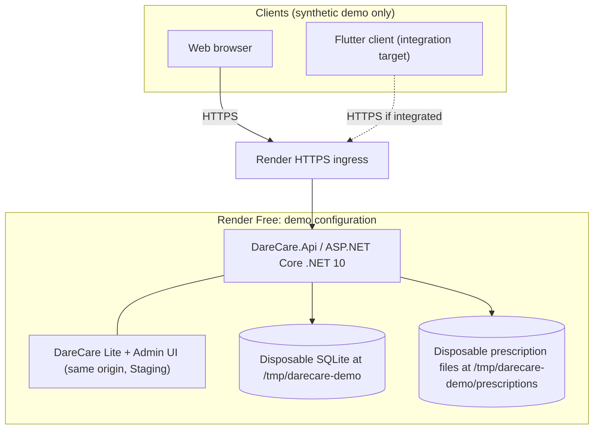
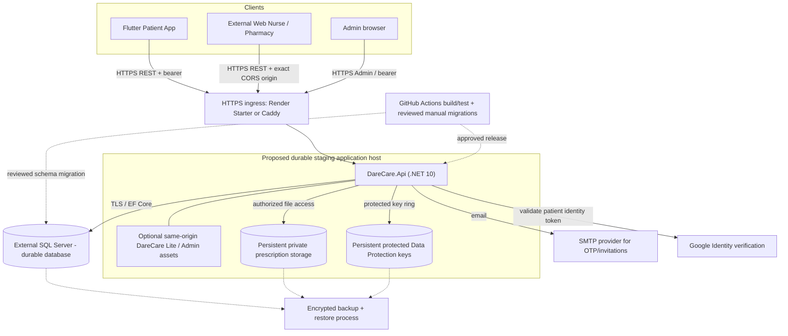
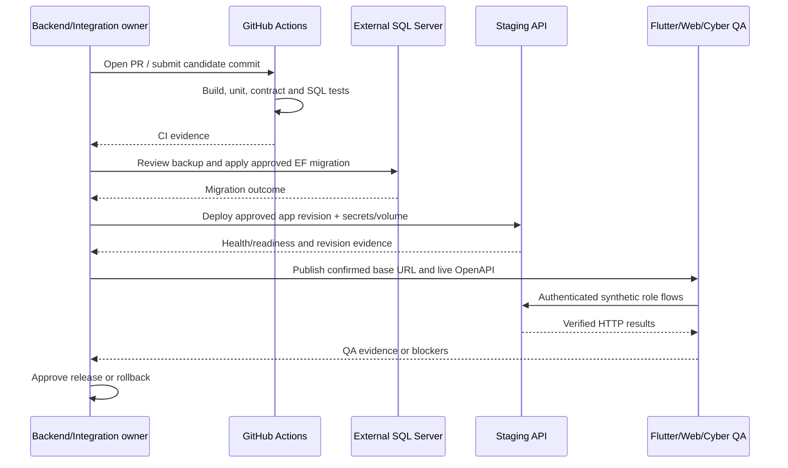

# DareCare — Deployment Diagrams | مخططات النشر

**Scope:** diagrams of the environment represented by existing source/configuration versus a proposed persistent staging environment. These are editable Mermaid diagrams rendered directly in GitHub; neither diagram is proof of a live deployment.

## A. Existing Render Free demonstration topology

**Source:** `Dockerfile`, `render.yaml`, `src/DareCare.Api/appsettings.Staging.json`, `docs/DARECARE_LITE_FRONTEND_AR.md`. SQLite and prescription uploads are temporary; restart/redeploy can remove them. No live integration success is inferred by the dashed Flutter edge.

## B. Proposed durable SQL Server staging (not verified active)

Notes:
- The existing `deployment/render-sqlserver-staging.yaml` configures SQL Server and a disk but **does not yet declare the Data Protection key directory**. It must be configured/mounted persistently before MFA is considered restart-safe.
- VPS alternative uses `deployment/compose.staging.yml` + `deployment/Caddyfile`; volumes and reverse proxy differ, while the logical design stays the same.
- SQL Server is **external** to the Render web service in the proposed Render blueprint; not hosted inside a temporary Docker container alongside the API.
- File storage and relational DB require consistent backup/restore. "Delivered" is an order state, not a third-party courier integration.
- Some external Web/Flutter clients are handoff deliverables, not confirmed deployed applications.

## C. Release-to-staging sequence

## What is tested vs proposed
| Element | Evidence in repository | External verification pending |
| --- | --- | --- |
| Render Free Docker/SQLite | Blueprint + CI container tests | Current public SHA and new routes |
| SQL Server schema and CI persistence | Committed EF migration + SQL CI | Dedicated durable staging database |
| Render Starter private disk | Config in YAML | Live private mount and backup/restore |
| Data Protection key persistence | Supported in Program.cs | Configured secure mounted directory and restart test |
| Web/Admin same origin | Source + local/CI tests | Actual public role-based browsing |
| Flutter and separate web portals | API starter/handoff docs | Same-backend HTTPS client E2E |

Related docs: `03_BACKEND_ARCHITECTURE.md`, `09_DEPLOYMENT_STRATEGY.md`, `docs/SPRINT8_SQLSERVER_AR.md`. This page fulfills the **diagram-documentation deliverable**, not the infrastructure rollout.
