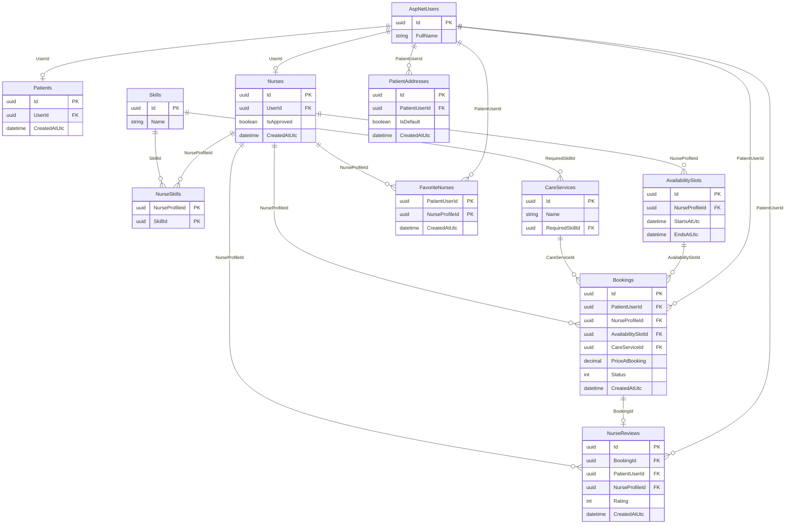
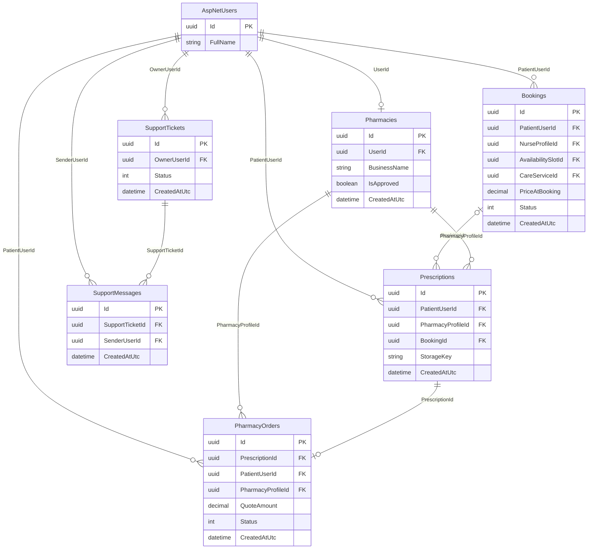

# DareCare — ER Diagram & Entity Relationships
**Owner:** Abdel Maqsoud | **Notion task:** ER Diagram | **Priority:** High | **Source baseline:** SQL Server migration `20261030184459_InitialSqlServer` on `darecare-demo-free` (19 Nov 2026).

## Purpose and notation
The diagrams below model the **actual database relationships**, not an imagined medical system. Source evidence: `src/DareCare.Infrastructure/Persistence/DareCareDbContext.cs` and `src/DareCare.Infrastructure/Persistence/Migrations/20261030184459_InitialSqlServer.cs`.

- `||--o{` means one parent can have zero or many child rows; each child references one parent.
- `||--o|` means one parent to zero or one child (a unique dependent FK).
- `o|--o{` on the optional booking reference expresses a prescription may have no linked booking.
- Table names and FK names are physical SQL Server names; repeated entities across diagrams are the **same table**, not new tables.
- `PK` / `FK` labels highlight key attributes. Composite PK fields are both primary-key members (often also foreign keys).
- The database has **25 tables** and **35 declared foreign keys** in this committed migration; diagrams are split for readability.

## 1. Identity, approvals, sessions and audit

```mermaid
erDiagram
    AspNetUsers {
        uuid Id PK
        string FullName
    }
    AspNetRoles {
        uuid Id PK
        string Name
    }
    AspNetUserRoles {
        uuid UserId PK
        uuid RoleId PK
    }
    AspNetUserClaims {
        int Id PK
        uuid UserId FK
    }
    AspNetRoleClaims {
        int Id PK
        uuid RoleId FK
    }
    AspNetUserLogins {
        string LoginProvider PK
        string ProviderKey PK
        uuid UserId FK
    }
    AspNetUserTokens {
        uuid UserId PK
        string LoginProvider PK
        string Name PK
    }
    RefreshSessions {
        uuid Id PK
        uuid UserId FK
        string TokenHash
        datetime CreatedAtUtc
    }
    Patients {
        uuid Id PK
        uuid UserId FK
        datetime CreatedAtUtc
    }
    Nurses {
        uuid Id PK
        uuid UserId FK
        boolean IsApproved
        datetime CreatedAtUtc
    }
    Pharmacies {
        uuid Id PK
        uuid UserId FK
        string BusinessName
        boolean IsApproved
        datetime CreatedAtUtc
    }
    AuditEvents {
        long Id PK
        uuid ActorUserId FK
    }
    Notifications {
        uuid Id PK
        uuid RecipientUserId FK
        datetime CreatedAtUtc
    }
    AspNetRoles ||--o{ AspNetRoleClaims : "RoleId"
    AspNetUsers ||--o{ AspNetUserClaims : "UserId"
    AspNetUsers ||--o{ AspNetUserLogins : "UserId"
    AspNetRoles ||--o{ AspNetUserRoles : "RoleId"
    AspNetUsers ||--o{ AspNetUserRoles : "UserId"
    AspNetUsers ||--o{ AspNetUserTokens : "UserId"
    AspNetUsers ||--o{ AuditEvents : "ActorUserId"
    AspNetUsers ||--o{ Notifications : "RecipientUserId"
    AspNetUsers ||--o| Nurses : "UserId"
    AspNetUsers ||--o| Patients : "UserId"
    AspNetUsers ||--o| Pharmacies : "UserId"
    AspNetUsers ||--o{ RefreshSessions : "UserId"
```

**Identity semantics:** An `AspNetUsers` record can hold role associations via `AspNetUserRoles`. `Patients`, `Nurses` and `Pharmacies` each have a unique `UserId` FK to `AspNetUsers` (0..1 profile per user for each type), **not** a direct FK to an Identity role row. Anonymous Pharmacy/Admin registration is disallowed by API policy, not by a separate physical ER relation.

## 2. Nursing, care bookings, addresses, favorites and reviews

**Important distinctions:** Booking patient ownership is `Bookings.PatientUserId → AspNetUsers.Id` and *not* `Patients.Id`. Bookings snapshot `ServiceAddress` at creation; they do **not** store `PatientAddress.Id` as an FK. `NurseSkills` implements the many-to-many nurse/skill association, and `FavoriteNurses` implements patient/nurse favorites with a composite key.

## 3. Pharmacy prescriptions, orders and support

**Prescriptions:** `BookingId` is nullable, so prescriptions **can exist without a completed-booking FK** depending on the allowed API flow. `PharmacyOrders.PrescriptionId` is a unique FK, allowing at most one quote/order record per prescription. `StorageKey` points to an external private filesystem object, **not** another SQL table. `SupportMessages` belong to support tickets and an `AspNetUsers` sender.

## Foreign-key inventory (all tables)
| Child table | FK column | Parent table | Meaning |
| --- | --- | --- | --- |
| `AspNetRoleClaims` | `RoleId` | `AspNetRoles.Id` | Enforced FK in migration |
| `AspNetUserClaims` | `UserId` | `AspNetUsers.Id` | Enforced FK in migration |
| `AspNetUserLogins` | `UserId` | `AspNetUsers.Id` | Enforced FK in migration |
| `AspNetUserRoles` | `RoleId` | `AspNetRoles.Id` | Enforced FK in migration |
| `AspNetUserRoles` | `UserId` | `AspNetUsers.Id` | Enforced FK in migration |
| `AspNetUserTokens` | `UserId` | `AspNetUsers.Id` | Enforced FK in migration |
| `AuditEvents` | `ActorUserId` | `AspNetUsers.Id` | Enforced FK in migration |
| `Notifications` | `RecipientUserId` | `AspNetUsers.Id` | Enforced FK in migration |
| `Nurses` | `UserId` | `AspNetUsers.Id` | Enforced FK in migration |
| `PatientAddresses` | `PatientUserId` | `AspNetUsers.Id` | Enforced FK in migration |
| `Patients` | `UserId` | `AspNetUsers.Id` | Enforced FK in migration |
| `Pharmacies` | `UserId` | `AspNetUsers.Id` | Enforced FK in migration |
| `RefreshSessions` | `UserId` | `AspNetUsers.Id` | Enforced FK in migration |
| `SupportTickets` | `OwnerUserId` | `AspNetUsers.Id` | Enforced FK in migration |
| `CareServices` | `RequiredSkillId` | `Skills.Id` | Enforced FK in migration |
| `AvailabilitySlots` | `NurseProfileId` | `Nurses.Id` | Enforced FK in migration |
| `FavoriteNurses` | `PatientUserId` | `AspNetUsers.Id` | Enforced FK in migration |
| `FavoriteNurses` | `NurseProfileId` | `Nurses.Id` | Enforced FK in migration |
| `NurseSkills` | `NurseProfileId` | `Nurses.Id` | Enforced FK in migration |
| `NurseSkills` | `SkillId` | `Skills.Id` | Enforced FK in migration |
| `SupportMessages` | `SenderUserId` | `AspNetUsers.Id` | Enforced FK in migration |
| `SupportMessages` | `SupportTicketId` | `SupportTickets.Id` | Enforced FK in migration |
| `Bookings` | `PatientUserId` | `AspNetUsers.Id` | Enforced FK in migration |
| `Bookings` | `AvailabilitySlotId` | `AvailabilitySlots.Id` | Enforced FK in migration |
| `Bookings` | `CareServiceId` | `CareServices.Id` | Enforced FK in migration |
| `Bookings` | `NurseProfileId` | `Nurses.Id` | Enforced FK in migration |
| `NurseReviews` | `PatientUserId` | `AspNetUsers.Id` | Enforced FK in migration |
| `NurseReviews` | `BookingId` | `Bookings.Id` | Enforced FK in migration |
| `NurseReviews` | `NurseProfileId` | `Nurses.Id` | Enforced FK in migration |
| `Prescriptions` | `PatientUserId` | `AspNetUsers.Id` | Enforced FK in migration |
| `Prescriptions` | `BookingId` | `Bookings.Id` | Optional booking link |
| `Prescriptions` | `PharmacyProfileId` | `Pharmacies.Id` | Enforced FK in migration |
| `PharmacyOrders` | `PatientUserId` | `AspNetUsers.Id` | Enforced FK in migration |
| `PharmacyOrders` | `PharmacyProfileId` | `Pharmacies.Id` | Enforced FK in migration |
| `PharmacyOrders` | `PrescriptionId` | `Prescriptions.Id` | Enforced FK in migration |

## Relationships and validation rules beyond the ER notation
1. **Provider approval** (`Nurses.IsApproved`, `Pharmacies.IsApproved`) is enforced by API flows; presence of a license string is not proof of official verification.
2. **Active slot uniqueness**: filtered unique index on `Bookings.AvailabilitySlotId` for statuses 0,1,2,3. Rejected/cancelled rows remain in history without blocking the slot.
3. **Default address**: filtered unique index prevents more than one `PatientAddresses.IsDefault=1` row per patient.
4. **Reviews**: unique `NurseReviews.BookingId`, plus rating check 1..5.
5. **Notification references**: `Notifications.ReferenceType` and nullable `ReferenceId` are *logical references*, not physical FKs to every referenced object.
6. **Concurrency**: `Bookings.RowVersion` (SQL Server) and `Version` GUID; order/ticket `Version` GUID. These are not relationships.
7. **Private uploaded files** live outside `wwwroot`; the database stores only prescription metadata. Do not draw a public file table.
8. **Schema scope**: 25 tables include ASP.NET Identity tables. This is a migration snapshot, not proof of the current hosted database.

## Acceptance / review checklist
- [x] Three editable ER diagrams covering the complete 25-table SQL Server migration.
- [x] Every migration foreign key appears in at least one diagram / inventory.
- [x] 1:1, 1:N and optional booking relationships distinguished.
- [x] Keys, owner boundaries, unique indexes and externally stored prescription files explained.
- [ ] Abdel Maqsoud reviews academic notation and supervisor-specific formatting.
- [ ] Backend reviewer checks changes against the **latest** EF model before final sign-off.
- [ ] Confirm diagram rendering in the actual GitHub Markdown view.
