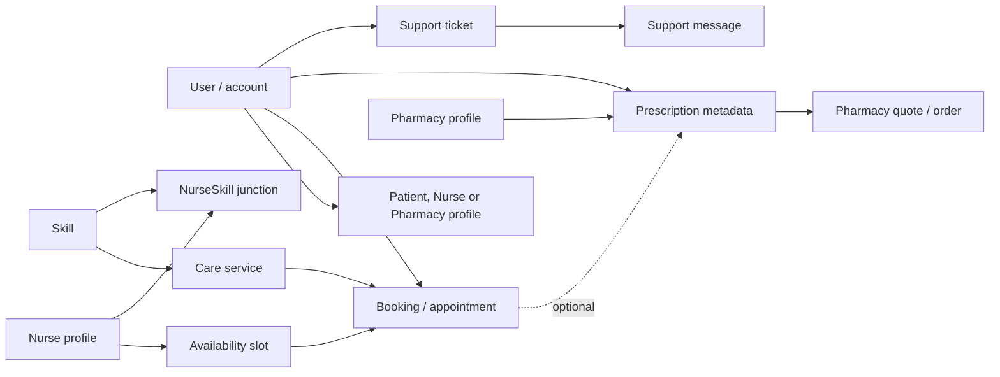

# DareCare — Logical & Physical Database Schema
**Owner:** Abdel Maqsoud | **Notion task:** Logical & Physical Schema | **Priority:** High.

## Source of truth and scope
Derived from the committed **SQL Server** EF Core migration `src/DareCare.Infrastructure/Persistence/Migrations/20261030184459_InitialSqlServer.cs` plus `DareCareDbContext.cs`. These descriptions are **not** a SQL Server deployment or migration execution. The database has **25 physical tables**, **35 FKs** and **43 declared indexes** in this migration. ASP.NET Identity is included; local disposable SQLite has provider-specific behavior.

## 1. Logical data model (business view)

| Logical area | Entities / concepts | Business relationship |
| --- | --- | --- |
| Identity and security | User, Role, UserRole, claims, logins, tokens, RefreshSession | Accounts are centrally managed; a user may hold role mappings and rotating sessions |
| Patient and providers | PatientProfile, NurseProfile, PharmacyProfile | Each profile has a unique user FK; nurse and pharmacy require admin approval |
| Catalog | Skill, CareService, NurseSkill | Each service requires one skill; nurses can have many skills |
| Scheduling | AvailabilitySlot, Booking, PatientAddress | Nurse owns slots; patient books one service and slot; address is copied as a booking snapshot |
| Feedback | NurseReview, FavoriteNurse | One review per completed booking; favorites are patient↔nurse junction rows |
| Medicine workflow | Prescription, PharmacyOrder | Patient creates private prescription metadata for an assigned pharmacy; max one quote/order per prescription |
| Service operations | SupportTicket, SupportMessage, Notification, AuditEvent | Owner-scoped support, recipient-scoped notifications and audit records |

**Logical versus physical:** e.g., "Patient" in the business model is represented by **AspNetUsers + Patients**, with bookings directly referencing **AspNetUsers.Id**, not the Patients profile key. The prescription binary file is outside SQL Server, with its path abstracted by a unique StorageKey.

## 2. Logical relationships — concise reference

*This simplified conceptual diagram intentionally omits technical FK repetition; see the complete physical FKs in `01_ER_DIAGRAM.md`.*

## 3. Physical SQL Server data dictionary
Legend: `PK` primary key, `FK` foreign key, `PK/FK` composite primary-key member also referencing a parent. Nullable is taken from the generated migration, not inferred from C# optional properties. SQL types are copied from the migration.

### `AspNetRoles`

| Column | SQL Server type | Nullable? | Key / parent |
| --- | --- | --- | --- |
| `Id` | `uniqueidentifier` | No | PK |
| `Name` | `nvarchar(256)` | Yes | — |
| `NormalizedName` | `nvarchar(256)` | Yes | — |
| `ConcurrencyStamp` | `nvarchar(max)` | Yes | — |

### `AspNetUsers`

| Column | SQL Server type | Nullable? | Key / parent |
| --- | --- | --- | --- |
| `Id` | `uniqueidentifier` | No | PK |
| `FullName` | `nvarchar(160)` | No | — |
| `RegisteredAtUtc` | `datetime2` | No | — |
| `IsActive` | `bit` | No | — |
| `TokenVersion` | `int` | No | — |
| `IsPendingInvitation` | `bit` | No | — |
| `UserName` | `nvarchar(256)` | Yes | — |
| `NormalizedUserName` | `nvarchar(256)` | Yes | — |
| `Email` | `nvarchar(256)` | Yes | — |
| `NormalizedEmail` | `nvarchar(256)` | Yes | — |
| `EmailConfirmed` | `bit` | No | — |
| `PasswordHash` | `nvarchar(max)` | Yes | — |
| `SecurityStamp` | `nvarchar(max)` | Yes | — |
| `ConcurrencyStamp` | `nvarchar(max)` | Yes | — |
| `PhoneNumber` | `nvarchar(max)` | Yes | — |
| `PhoneNumberConfirmed` | `bit` | No | — |
| `TwoFactorEnabled` | `bit` | No | — |
| `LockoutEnd` | `datetimeoffset` | Yes | — |
| `LockoutEnabled` | `bit` | No | — |
| `AccessFailedCount` | `int` | No | — |

### `Skills`

| Column | SQL Server type | Nullable? | Key / parent |
| --- | --- | --- | --- |
| `Id` | `uniqueidentifier` | No | PK |
| `Name` | `nvarchar(120)` | No | — |

### `AspNetRoleClaims`

| Column | SQL Server type | Nullable? | Key / parent |
| --- | --- | --- | --- |
| `Id` | `int` | No | PK |
| `RoleId` | `uniqueidentifier` | No | FK → AspNetRoles.Id |
| `ClaimType` | `nvarchar(max)` | Yes | — |
| `ClaimValue` | `nvarchar(max)` | Yes | — |

### `AspNetUserClaims`

| Column | SQL Server type | Nullable? | Key / parent |
| --- | --- | --- | --- |
| `Id` | `int` | No | PK |
| `UserId` | `uniqueidentifier` | No | FK → AspNetUsers.Id |
| `ClaimType` | `nvarchar(max)` | Yes | — |
| `ClaimValue` | `nvarchar(max)` | Yes | — |

### `AspNetUserLogins`

| Column | SQL Server type | Nullable? | Key / parent |
| --- | --- | --- | --- |
| `LoginProvider` | `nvarchar(450)` | No | PK |
| `ProviderKey` | `nvarchar(450)` | No | PK |
| `ProviderDisplayName` | `nvarchar(max)` | Yes | — |
| `UserId` | `uniqueidentifier` | No | FK → AspNetUsers.Id |

### `AspNetUserRoles`

| Column | SQL Server type | Nullable? | Key / parent |
| --- | --- | --- | --- |
| `UserId` | `uniqueidentifier` | No | PK/FK → AspNetUsers.Id |
| `RoleId` | `uniqueidentifier` | No | PK/FK → AspNetRoles.Id |

### `AspNetUserTokens`

| Column | SQL Server type | Nullable? | Key / parent |
| --- | --- | --- | --- |
| `UserId` | `uniqueidentifier` | No | PK/FK → AspNetUsers.Id |
| `LoginProvider` | `nvarchar(450)` | No | PK |
| `Name` | `nvarchar(450)` | No | PK |
| `Value` | `nvarchar(max)` | Yes | — |

### `AuditEvents`

| Column | SQL Server type | Nullable? | Key / parent |
| --- | --- | --- | --- |
| `Id` | `bigint` | No | PK |
| `ActorUserId` | `uniqueidentifier` | No | FK → AspNetUsers.Id |
| `Action` | `nvarchar(100)` | No | — |
| `EntityType` | `nvarchar(100)` | No | — |
| `EntityId` | `nvarchar(80)` | No | — |
| `OccurredAtUtc` | `datetime2` | No | — |

### `Notifications`

| Column | SQL Server type | Nullable? | Key / parent |
| --- | --- | --- | --- |
| `Id` | `uniqueidentifier` | No | PK |
| `RecipientUserId` | `uniqueidentifier` | No | FK → AspNetUsers.Id |
| `Title` | `nvarchar(160)` | No | — |
| `Message` | `nvarchar(800)` | No | — |
| `ReferenceType` | `nvarchar(60)` | Yes | — |
| `ReferenceId` | `uniqueidentifier` | Yes | — |
| `CreatedAtUtc` | `datetime2` | No | — |
| `ReadAtUtc` | `datetime2` | Yes | — |

### `Nurses`

| Column | SQL Server type | Nullable? | Key / parent |
| --- | --- | --- | --- |
| `Id` | `uniqueidentifier` | No | PK |
| `UserId` | `uniqueidentifier` | No | FK → AspNetUsers.Id |
| `LicenseNumber` | `nvarchar(80)` | No | — |
| `Bio` | `nvarchar(1500)` | Yes | — |
| `City` | `nvarchar(120)` | Yes | — |
| `ServiceArea` | `nvarchar(250)` | Yes | — |
| `YearsOfExperience` | `int` | No | — |
| `HourlyRate` | `decimal(18,2)` | No | — |
| `IsApproved` | `bit` | No | — |
| `CreatedAtUtc` | `datetime2` | No | — |

### `PatientAddresses`

| Column | SQL Server type | Nullable? | Key / parent |
| --- | --- | --- | --- |
| `Id` | `uniqueidentifier` | No | PK |
| `PatientUserId` | `uniqueidentifier` | No | FK → AspNetUsers.Id |
| `Label` | `nvarchar(50)` | No | — |
| `City` | `nvarchar(120)` | No | — |
| `FullAddress` | `nvarchar(250)` | No | — |
| `Notes` | `nvarchar(300)` | Yes | — |
| `IsDefault` | `bit` | No | — |
| `CreatedAtUtc` | `datetime2` | No | — |
| `UpdatedAtUtc` | `datetime2` | No | — |

### `Patients`

| Column | SQL Server type | Nullable? | Key / parent |
| --- | --- | --- | --- |
| `Id` | `uniqueidentifier` | No | PK |
| `UserId` | `uniqueidentifier` | No | FK → AspNetUsers.Id |
| `CreatedAtUtc` | `datetime2` | No | — |
| `City` | `nvarchar(120)` | Yes | — |
| `DefaultAddress` | `nvarchar(400)` | Yes | — |
| `EmergencyContactName` | `nvarchar(160)` | Yes | — |
| `EmergencyContactPhone` | `nvarchar(32)` | Yes | — |

### `Pharmacies`

| Column | SQL Server type | Nullable? | Key / parent |
| --- | --- | --- | --- |
| `Id` | `uniqueidentifier` | No | PK |
| `UserId` | `uniqueidentifier` | No | FK → AspNetUsers.Id |
| `BusinessName` | `nvarchar(180)` | No | — |
| `LicenseNumber` | `nvarchar(80)` | No | — |
| `City` | `nvarchar(120)` | No | — |
| `Address` | `nvarchar(400)` | No | — |
| `IsApproved` | `bit` | No | — |
| `CreatedAtUtc` | `datetime2` | No | — |

### `RefreshSessions`

| Column | SQL Server type | Nullable? | Key / parent |
| --- | --- | --- | --- |
| `Id` | `uniqueidentifier` | No | PK |
| `UserId` | `uniqueidentifier` | No | FK → AspNetUsers.Id |
| `FamilyId` | `uniqueidentifier` | No | — |
| `TokenVersion` | `int` | No | — |
| `TokenHash` | `nvarchar(64)` | No | — |
| `CreatedAtUtc` | `datetime2` | No | — |
| `ExpiresAtUtc` | `datetime2` | No | — |
| `RevokedAtUtc` | `datetime2` | Yes | — |
| `ReplacedByHash` | `nvarchar(64)` | Yes | — |

### `SupportTickets`

| Column | SQL Server type | Nullable? | Key / parent |
| --- | --- | --- | --- |
| `Id` | `uniqueidentifier` | No | PK |
| `OwnerUserId` | `uniqueidentifier` | No | FK → AspNetUsers.Id |
| `Subject` | `nvarchar(160)` | No | — |
| `Category` | `int` | No | — |
| `Status` | `int` | No | — |
| `CreatedAtUtc` | `datetime2` | No | — |
| `UpdatedAtUtc` | `datetime2` | No | — |
| `Version` | `uniqueidentifier` | No | — |

### `CareServices`

| Column | SQL Server type | Nullable? | Key / parent |
| --- | --- | --- | --- |
| `Id` | `uniqueidentifier` | No | PK |
| `Name` | `nvarchar(180)` | No | — |
| `Description` | `nvarchar(800)` | No | — |
| `DurationMinutes` | `int` | No | — |
| `BasePrice` | `decimal(18,2)` | No | — |
| `IsActive` | `bit` | No | — |
| `RequiredSkillId` | `uniqueidentifier` | No | FK → Skills.Id |

### `AvailabilitySlots`

| Column | SQL Server type | Nullable? | Key / parent |
| --- | --- | --- | --- |
| `Id` | `uniqueidentifier` | No | PK |
| `NurseProfileId` | `uniqueidentifier` | No | FK → Nurses.Id |
| `StartsAtUtc` | `datetime2` | No | — |
| `EndsAtUtc` | `datetime2` | No | — |

### `FavoriteNurses`

| Column | SQL Server type | Nullable? | Key / parent |
| --- | --- | --- | --- |
| `PatientUserId` | `uniqueidentifier` | No | PK/FK → AspNetUsers.Id |
| `NurseProfileId` | `uniqueidentifier` | No | PK/FK → Nurses.Id |
| `CreatedAtUtc` | `datetime2` | No | — |

### `NurseSkills`

| Column | SQL Server type | Nullable? | Key / parent |
| --- | --- | --- | --- |
| `NurseProfileId` | `uniqueidentifier` | No | PK/FK → Nurses.Id |
| `SkillId` | `uniqueidentifier` | No | PK/FK → Skills.Id |

### `SupportMessages`

| Column | SQL Server type | Nullable? | Key / parent |
| --- | --- | --- | --- |
| `Id` | `uniqueidentifier` | No | PK |
| `SupportTicketId` | `uniqueidentifier` | No | FK → SupportTickets.Id |
| `SenderUserId` | `uniqueidentifier` | No | FK → AspNetUsers.Id |
| `Body` | `nvarchar(4000)` | No | — |
| `IsStaffReply` | `bit` | No | — |
| `CreatedAtUtc` | `datetime2` | No | — |

### `Bookings`

| Column | SQL Server type | Nullable? | Key / parent |
| --- | --- | --- | --- |
| `Id` | `uniqueidentifier` | No | PK |
| `PatientUserId` | `uniqueidentifier` | No | FK → AspNetUsers.Id |
| `NurseProfileId` | `uniqueidentifier` | No | FK → Nurses.Id |
| `AvailabilitySlotId` | `uniqueidentifier` | No | FK → AvailabilitySlots.Id |
| `CareServiceId` | `uniqueidentifier` | No | FK → CareServices.Id |
| `ServiceAddress` | `nvarchar(400)` | No | — |
| `PriceAtBooking` | `decimal(18,2)` | No | — |
| `Status` | `int` | No | — |
| `CreatedAtUtc` | `datetime2` | No | — |
| `UpdatedAtUtc` | `datetime2` | No | — |
| `RowVersion` | `rowversion` | No | — |
| `Version` | `uniqueidentifier` | No | — |

### `NurseReviews`

| Column | SQL Server type | Nullable? | Key / parent |
| --- | --- | --- | --- |
| `Id` | `uniqueidentifier` | No | PK |
| `BookingId` | `uniqueidentifier` | No | FK → Bookings.Id |
| `PatientUserId` | `uniqueidentifier` | No | FK → AspNetUsers.Id |
| `NurseProfileId` | `uniqueidentifier` | No | FK → Nurses.Id |
| `Rating` | `int` | No | — |
| `Comment` | `nvarchar(1000)` | Yes | — |
| `CreatedAtUtc` | `datetime2` | No | — |

### `Prescriptions`

| Column | SQL Server type | Nullable? | Key / parent |
| --- | --- | --- | --- |
| `Id` | `uniqueidentifier` | No | PK |
| `PatientUserId` | `uniqueidentifier` | No | FK → AspNetUsers.Id |
| `PharmacyProfileId` | `uniqueidentifier` | No | FK → Pharmacies.Id |
| `BookingId` | `uniqueidentifier` | Yes | FK → Bookings.Id |
| `PatientNotes` | `nvarchar(1000)` | Yes | — |
| `OriginalFileName` | `nvarchar(180)` | No | — |
| `ContentType` | `nvarchar(80)` | No | — |
| `StorageKey` | `nvarchar(36)` | No | — |
| `FileSizeBytes` | `bigint` | No | — |
| `CreatedAtUtc` | `datetime2` | No | — |

### `PharmacyOrders`

| Column | SQL Server type | Nullable? | Key / parent |
| --- | --- | --- | --- |
| `Id` | `uniqueidentifier` | No | PK |
| `PrescriptionId` | `uniqueidentifier` | No | FK → Prescriptions.Id |
| `PatientUserId` | `uniqueidentifier` | No | FK → AspNetUsers.Id |
| `PharmacyProfileId` | `uniqueidentifier` | No | FK → Pharmacies.Id |
| `QuoteAmount` | `decimal(18,2)` | No | — |
| `QuoteNotes` | `nvarchar(1500)` | Yes | — |
| `Status` | `int` | No | — |
| `CreatedAtUtc` | `datetime2` | No | — |
| `UpdatedAtUtc` | `datetime2` | No | — |
| `Version` | `uniqueidentifier` | No | — |

## 4. Index catalog (migration declarations)
| Table | Index | Column(s) | Unique? | Filter |
| --- | --- | --- | --- | --- |
| `AspNetRoleClaims` | `IX_AspNetRoleClaims_RoleId` | `RoleId` | No | — |
| `AspNetRoles` | `RoleNameIndex` | `NormalizedName` | Yes | `[NormalizedName] IS NOT NULL` |
| `AspNetUserClaims` | `IX_AspNetUserClaims_UserId` | `UserId` | No | — |
| `AspNetUserLogins` | `IX_AspNetUserLogins_UserId` | `UserId` | No | — |
| `AspNetUserRoles` | `IX_AspNetUserRoles_RoleId` | `RoleId` | No | — |
| `AspNetUsers` | `EmailIndex` | `NormalizedEmail` | Yes | `[NormalizedEmail] IS NOT NULL` |
| `AspNetUsers` | `UserNameIndex` | `NormalizedUserName` | Yes | `[NormalizedUserName] IS NOT NULL` |
| `AuditEvents` | `IX_AuditEvents_ActorUserId` | `ActorUserId` | No | — |
| `AuditEvents` | `IX_AuditEvents_OccurredAtUtc` | `OccurredAtUtc` | No | — |
| `AvailabilitySlots` | `IX_AvailabilitySlots_NurseProfileId_StartsAtUtc` | `NurseProfileId`, `StartsAtUtc` | No | — |
| `Bookings` | `IX_Bookings_AvailabilitySlotId` | `AvailabilitySlotId` | Yes | `[Status] IN (0, 1, 2, 3)` |
| `Bookings` | `IX_Bookings_CareServiceId` | `CareServiceId` | No | — |
| `Bookings` | `IX_Bookings_NurseProfileId` | `NurseProfileId` | No | — |
| `Bookings` | `IX_Bookings_PatientUserId_CreatedAtUtc` | `PatientUserId`, `CreatedAtUtc` | No | — |
| `CareServices` | `IX_CareServices_RequiredSkillId` | `RequiredSkillId` | No | — |
| `FavoriteNurses` | `IX_FavoriteNurses_NurseProfileId` | `NurseProfileId` | No | — |
| `Notifications` | `IX_Notifications_RecipientUserId_CreatedAtUtc` | `RecipientUserId`, `CreatedAtUtc` | No | — |
| `NurseReviews` | `IX_NurseReviews_BookingId` | `BookingId` | Yes | — |
| `NurseReviews` | `IX_NurseReviews_NurseProfileId_CreatedAtUtc` | `NurseProfileId`, `CreatedAtUtc` | No | — |
| `NurseReviews` | `IX_NurseReviews_PatientUserId_CreatedAtUtc` | `PatientUserId`, `CreatedAtUtc` | No | — |
| `Nurses` | `IX_Nurses_LicenseNumber` | `LicenseNumber` | Yes | — |
| `Nurses` | `IX_Nurses_UserId` | `UserId` | Yes | — |
| `NurseSkills` | `IX_NurseSkills_SkillId` | `SkillId` | No | — |
| `PatientAddresses` | `IX_PatientAddresses_PatientUserId_CreatedAtUtc` | `PatientUserId`, `CreatedAtUtc` | No | — |
| `PatientAddresses` | `IX_PatientAddresses_PatientUserId_IsDefault` | `PatientUserId`, `IsDefault` | Yes | `[IsDefault] = 1` |
| `Patients` | `IX_Patients_UserId` | `UserId` | Yes | — |
| `Pharmacies` | `IX_Pharmacies_LicenseNumber` | `LicenseNumber` | Yes | — |
| `Pharmacies` | `IX_Pharmacies_UserId` | `UserId` | Yes | — |
| `PharmacyOrders` | `IX_PharmacyOrders_PatientUserId_CreatedAtUtc` | `PatientUserId`, `CreatedAtUtc` | No | — |
| `PharmacyOrders` | `IX_PharmacyOrders_PharmacyProfileId_CreatedAtUtc` | `PharmacyProfileId`, `CreatedAtUtc` | No | — |
| `PharmacyOrders` | `IX_PharmacyOrders_PrescriptionId` | `PrescriptionId` | Yes | — |
| `Prescriptions` | `IX_Prescriptions_BookingId` | `BookingId` | No | — |
| `Prescriptions` | `IX_Prescriptions_PatientUserId_CreatedAtUtc` | `PatientUserId`, `CreatedAtUtc` | No | — |
| `Prescriptions` | `IX_Prescriptions_PharmacyProfileId_CreatedAtUtc` | `PharmacyProfileId`, `CreatedAtUtc` | No | — |
| `Prescriptions` | `IX_Prescriptions_StorageKey` | `StorageKey` | Yes | — |
| `RefreshSessions` | `IX_RefreshSessions_FamilyId` | `FamilyId` | No | — |
| `RefreshSessions` | `IX_RefreshSessions_TokenHash` | `TokenHash` | Yes | — |
| `RefreshSessions` | `IX_RefreshSessions_UserId_ExpiresAtUtc` | `UserId`, `ExpiresAtUtc` | No | — |
| `Skills` | `IX_Skills_Name` | `Name` | Yes | — |
| `SupportMessages` | `IX_SupportMessages_SenderUserId` | `SenderUserId` | No | — |
| `SupportMessages` | `IX_SupportMessages_SupportTicketId_CreatedAtUtc` | `SupportTicketId`, `CreatedAtUtc` | No | — |
| `SupportTickets` | `IX_SupportTickets_OwnerUserId_CreatedAtUtc` | `OwnerUserId`, `CreatedAtUtc` | No | — |
| `SupportTickets` | `IX_SupportTickets_Status_CreatedAtUtc` | `Status`, `CreatedAtUtc` | No | — |

## 5. Check constraints and integrity guarantees
| Constraint | Table | Condition | Rationale |
| --- | --- | --- | --- |
| `CK_Slot_ValidTime` | `AvailabilitySlots` | `EndsAtUtc > StartsAtUtc` | Prevent invalid time intervals |
| `CK_Review_Rating` | `NurseReviews` | `Rating >= 1 AND Rating <= 5` | Restrict rating to 1–5 |
| `CK_Order_NonnegativeQuote` | `PharmacyOrders` | `QuoteAmount > 0` | Positive pharmacy quote |

Other important database rules:
- **One active booking per slot**: `IX_Bookings_AvailabilitySlotId` unique when `Status IN (0,1,2,3)`. Enum mapping: Pending=0, Accepted=1, InProgress=2, Completed=3, Cancelled=4, Rejected=5.
- **One default saved address per patient**: `IX_PatientAddresses_PatientUserId_IsDefault` unique filtered by `[IsDefault] = 1`.
- **One review per booking**: `IX_NurseReviews_BookingId` unique.
- **One pharmacy order per prescription**: `IX_PharmacyOrders_PrescriptionId` unique.
- **Unique approved provider license identifiers**: `IX_Nurses_LicenseNumber` and `IX_Pharmacies_LicenseNumber` are unique independent of approval status.
- **Token isolation**: `RefreshSessions.TokenHash` is uniquely indexed; no raw refresh token column is stored.
- **Booking concurrency**: SQL Server `rowversion` plus application GUID `Version`. `PharmacyOrders.Version` and `SupportTickets.Version` are application concurrency tokens.
- **Relationships**: all `35` FKs are listed in [ER Diagram](01_ER_DIAGRAM.md), where optional and unique relations are explained.
- **Files**: `Prescriptions.StorageKey` is an opaque unique server-side storage locator, not a foreign key or a public URL.

## 6. Migration, implementation and release boundaries
1. SQL Server production-like staging uses **reviewed EF Core migrations** on a new empty database; the app refuses startup when SQL Server schema has pending migrations. Do not replace this with `EnsureCreated`.
2. Local/Render Free SQLite is disposable and **not the same physical schema** in every SQL Server-specific feature (notably SQL Server `rowversion` and provider-generated indexes).
3. Review `dotnet ef migrations script --idempotent` before applying, never publish credentials; take a consistent database and private-file backup for durable environments.
4. The current schema has **no** physical payment gateway, medication inventory, licensed courier, medical diagnosis record, or pharmacy warehouse model. Do not add imagined tables to the academic diagram.
5. A schema document is not proof of a live persistent SQL Server: refer to [Deployment Strategy](../project-management/09_DEPLOYMENT_STRATEGY.md) and the SQL integration CI for the separate checks.

## Acceptance / review checklist
- [x] Logical data model and physical SQL Server data dictionary for every declared table and column.
- [x] All PK/FK pairs, index declarations, unique filtered constraints and checks covered.
- [x] Physical file-storage boundary and SQL Server vs SQLite caveat documented.
- [ ] Review with the database/backend owner for future migration changes.
- [ ] Run the reviewed migration and schema validation on the **target** staging database separately; this document does not assert that step occurred.
